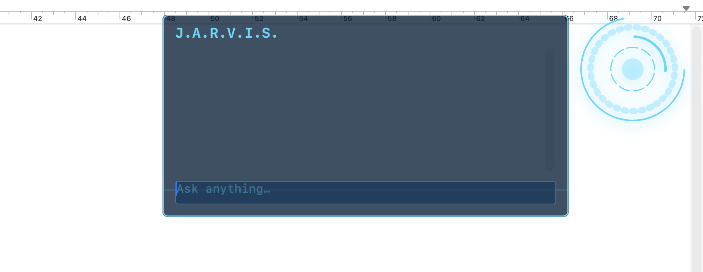
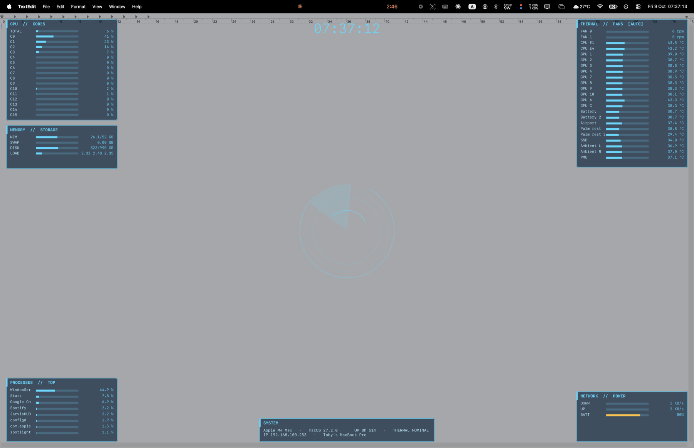

<p align="center">
  
</p>

<h1 align="center">JarvisHUD</h1>

<p align="center">
  Replace Siri on your Mac with an Iron Man <b>J.A.R.V.I.S.</b> style assistant.<br>
  Chat through <b>Groq, Gemini, OpenAI, Anthropic, OpenRouter, Ollama</b> or any OpenAI-compatible API, a live telemetry overlay with real sensor data, and fan control. All from the menu bar.
</p>

---

## What it does

| Shortcut | Action |
|---|---|
| **⌥ Space** | Summon JARVIS. A glowing ring spins up in the top-right corner, a panel expands leftward, and you type. Press again or hit Esc to dismiss. |
| **⌃⌥ Space** | Toggle the telemetry overlay. Live stats are painted around the edges of the screen. |
| **"Jarvis, …"** | Wake word. While listening (automatically on AC power, or forced on from the menu) just say *Jarvis* followed by your question. The HUD pops up, your words appear as you speak, and the question is sent when you pause. |
| **◎ menu** | AI provider, web search, wake word, memory, risky-action confirmation, fan control, clear conversation, quit. |

### JARVIS is an agent

He doesn't just answer, he acts. Every reply can call a tool, read the result and continue, up to eight steps, with each step shown dimly in the panel as it happens. Tools:

- **shell**: run any zsh command
- **applescript**: control apps, Finder, Music, volume, notifications
- **open**: launch an app, URL or file
- **read_file / write_file**
- **search**: web search, if configured
- **telemetry**: a fresh sensor snapshot
- **fans**: set or release cooling fans
- **clipboard**: read or set
- **recall**: search everything he has heard (see below)
- **remember / forget**: keep or drop a note permanently

> *Clean up the screenshots on my desktop into a folder.*
> *What's using port 3000? Kill it.*
> *Open the last PDF I downloaded.*
> *Set the volume to 20 and play some jazz.*

Risky actions (deleting, sudo, AppleScript, writing files, installs, network downloads) ask first, right inside the panel: press Return to allow or Esc to deny. Turn that off under ◎ → *Ask Before Risky Actions* if you trust him completely. This works with every provider because it uses a plain-text tool protocol rather than provider-specific function calling.

### Always listening, with a memory

With the wake word on, JARVIS listens 24/7 through the Mac's microphone using Apple's **on-device** speech recognition. Audio never leaves the machine; only the question you ask him is sent to your AI provider. Everything he hears is written, with a timestamp, to a plain-text log in `~/Library/Application Support/JarvisHUD/heard/` and kept for 14 days. That log is what lets him answer about your day:

> *Jarvis, remember I left the car keys in the blue bowl by the door.*
> *Jarvis, where did I leave my keys?*
> *Jarvis, what did we decide about the deadline in that call this morning?*
> *Jarvis, what happened today?*

"Remember" stores a permanent note (`notes.json`, always visible to him). Anything else he looks up with the **recall** tool, which searches the heard log by keyword or by time window. Speech-to-text is imperfect, so he treats the log as approximate.

Listening modes under ◎ → *Wake Word "Jarvis"*: **Automatic** (on while plugged in, off on battery), **Always On**, **Off**. The menu bar icon shows 🎙 while he is listening, and macOS shows its orange microphone indicator. The same submenu has *Forget Today's Transcript*, *Forget Everything Heard*, *Forget Remembered Notes* and *Show Memory Folder*. It is your Mac and your log: delete it whenever you like.

### JARVIS, in character

Replies come back the way he talks in the films: calm British butler, dry deadpan wit, "sir" when it fits, and short status-readout answers. Works with any model. Every question also carries a snapshot of your Mac's live telemetry, so you can just ask:

> *How's the machine running?*
> *Are the fans okay? Spin them up to 4000.*
> *What's eating my CPU?*

### Web search

Give JARVIS a search key and he looks things up when a question needs current information: news, prices, weather, docs. He decides when to search, the panel shows *SEARCHING: query* while it runs, and he answers from the results with a brief source mention.

| Provider | Key |
|---|---|
| Tavily | app.tavily.com (free tier) |
| Brave Search | api.search.brave.com (free tier) |
| Serper (Google results) | serper.dev (free tier) |

Set it under ◎ → *Web Search…*. Leave it Off and he'll simply tell you he can't browse.

### Telemetry overlay

<p align="center">
  
</p>

Click-through, refreshed every second, and it re-fits itself when you enter or leave a full-screen app.

- **CPU** total plus every core
- **Memory, swap, disk, load average**
- **Top processes** by CPU
- **Thermal and fans** read straight from the SMC: each fan in rpm against its maximum, plus CPU, GPU, battery, SSD, ambient, PMU and palm-rest temperatures
- **Network** down and up throughput, **battery** percent and time remaining
- **System** chip, macOS version, uptime, thermal pressure, IP, hostname
- Bars turn amber past 60 percent and red past 85 percent

### Fan control

Apple Silicon fans can only be set as root, so JarvisHUD ships a tiny helper binary (`jarvisfan`) that you install once from the menu with an admin password prompt. After that:

- **◎ → Fans** gives you Automatic, fixed speeds, or Maximum
- Or ask JARVIS in plain English. He confirms in character and the app executes it.
- The overlay shows `[AUTO]` or `[MANUAL]` in the thermal card title
- Fans always return to automatic when the app quits

Speeds are clamped to the fan's own min and max as reported by the SMC.

## Install

### From the DMG

1. Download `JarvisHUD.dmg` from the [latest release](../../releases/latest).
2. Open it and drag **JarvisHUD** to **Applications**.
3. Launch it. The build is signed with a personal developer certificate, not notarized, so the first time macOS may block it: open **System Settings → Privacy & Security** and click **Open Anyway**.

### From source

```sh
git clone https://github.com/tobyyu913/JarvisHUD.git
cd JarvisHUD
./build.sh          # builds build/JarvisHUD.app
./make-dmg.sh       # optional: also packages build/JarvisHUD.dmg
open build/JarvisHUD.app
```

Needs the Xcode command line tools. Edit `SIGN` in `build.sh` to your own signing identity. Ad-hoc signing (`-`) works too, but macOS will re-ask for permissions after every rebuild because the app's identity changes.

## First-run setup

1. **Permissions.** Grant **Accessibility** and **Input Monitoring** when prompted, then quit and relaunch from the ◎ menu. This is what lets the app see the hotkey and swallow it before Siri does.
2. **AI provider.** ◎ → *AI Provider…*, pick a preset, paste your key. Groq is the default (fast and free tier friendly). Presets fill in the base URL and a sensible model; edit either freely.

   | Preset | Protocol | Default model | Key |
   |---|---|---|---|
   | Groq | OpenAI-compatible | `llama-3.3-70b-versatile` | console.groq.com/keys |
   | Gemini | Google native | `gemini-2.5-flash` | aistudio.google.com/apikey |
   | OpenAI | OpenAI | `gpt-4o-mini` | platform.openai.com |
   | Anthropic | Messages API | `claude-opus-5-5` | console.anthropic.com |
   | OpenRouter, xAI, Mistral | OpenAI-compatible | varies | their consoles |
   | Ollama, LM Studio | OpenAI-compatible, local | whatever you've pulled | none |
   | Custom | OpenAI-compatible | yours | yours |

   Anything that speaks the OpenAI `chat/completions` format works via *Custom*: just set the base URL (ending in `/v1`) and model name.
3. **Wake word.** On first launch (on AC power) macOS asks for **Speech Recognition** and **Microphone**. Allow both. Apple's prompt says speech "may be sent to Apple"; this app requests on-device recognition, which every Apple Silicon Mac supports, so it stays local.
4. **Web search (optional).** ◎ → *Web Search…*, pick Tavily, Brave or Serper, paste the key.
5. **Fans (optional).** ◎ → Fans → *Install Fan Control Helper…*

The API key is stored in the app's own preferences on your Mac and is sent only to the provider you chose. The search key goes only to the search provider you chose.

## Android version

The same JARVIS for your phone, in [`android/`](android/). It registers as the phone's **default digital assistant**, the same hook 小爱同学 (XiaoAI) or Google Assistant use, so long-press home / the power-button gesture summons the cyan ring and panel instead.

- Same persona, same providers (Groq, Gemini, OpenAI, Anthropic, any OpenAI-compatible URL), same web search keys.
- Agent tools on Android: open apps, open URLs, alarms, timers, reminders for deadlines, clipboard, telemetry (battery, memory, storage, network), plus remember / forget / recall.
- Speech is fully **offline** with a bundled Vosk English model, so it works on Xiaomi phones without Google services. Nothing but the question text leaves the phone.
- Wake word "Jarvis" runs as a foreground service (Automatic while charging / Always on / Off) and logs everything heard, for 14 days, to the app's private storage, like the Mac version.

**Install:** download `JarvisHUD-android.apk` from Releases, install it, open JARVIS, grant microphone + notifications, set your AI key, then tap *Open assistant settings* and choose JARVIS as the digital assistant app. On Xiaomi / HyperOS also allow **"Display pop-up windows while running in the background"** for JARVIS under App info → Other permissions, otherwise the system blocks the HUD from appearing over other apps.

**Xiaomi power button:** HyperOS wires "long press power" straight to 小爱's own package, ignoring the assistant setting. In JARVIS tap **Take over power button (Xiaomi)** (it asks for *Modify system settings* once); it switches the shortcut to the one value that goes through the system assistant, so holding power summons JARVIS. The same change by hand: Settings → Additional settings → Button shortcuts → Long press power → Google Assistant. Updating the APK on HyperOS can reset the microphone and pop-up permissions, so re-check them after an update.

Build from source: `cd android && ./gradlew assembleDebug` (Gradle 8.9, AGP 8.7.3, JDK 17).

## Compatibility

Built and tested on an M4 Max MacBook Pro running macOS 27. It should work on any Apple Silicon Mac, but SMC temperature key names differ between chips. If some sensors are missing or look wrong on your machine, adjust the `tempKeys` list in `Sources/Stats.swift`.

## Project layout

```
Sources/main.swift      app, hotkeys, chat HUD, multi-provider AI client, agent tool loop, JARVIS persona, fan-control bridge
Sources/Voice.swift     always-on wake word (on-device speech recognition, AC-power auto mode)
Sources/Memory.swift    persistent heard-log and remembered notes
Sources/Overlay.swift   edge telemetry overlay and full-screen handling
Sources/Stats.swift     SMC reader/writer, CPU/memory/disk/network/battery metrics
Helper/main.swift       jarvisfan setuid helper
build.sh                compile and sign the .app
make-dmg.sh             build and package the .dmg
```

## Credits

Visual style inspired by the J.A.R.V.I.S. interfaces in Marvel's Iron Man films. Not affiliated with Marvel, Apple, Google, Groq, OpenAI or Anthropic.
